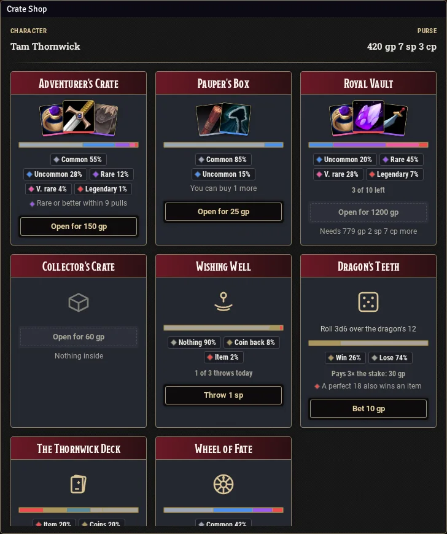
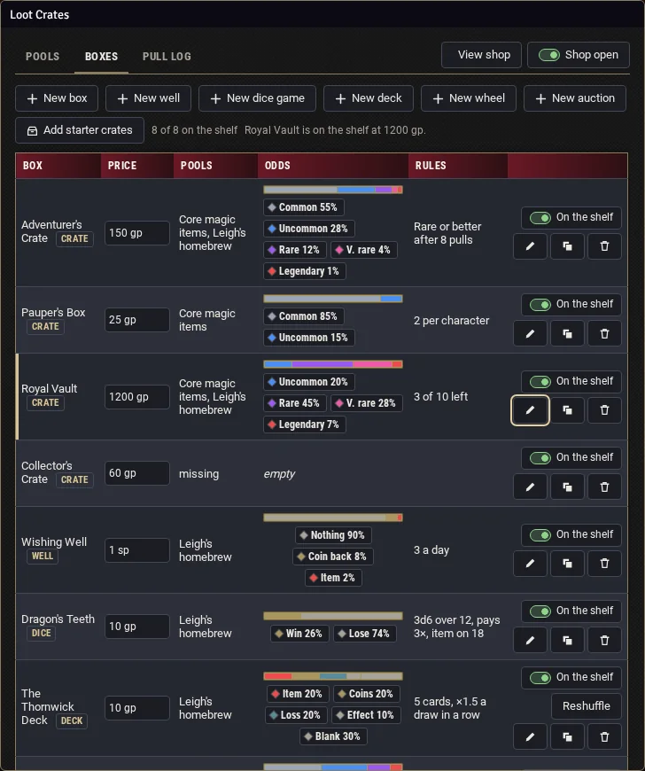
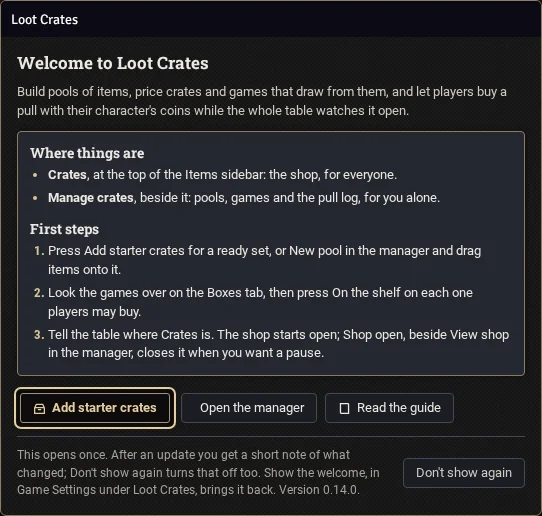
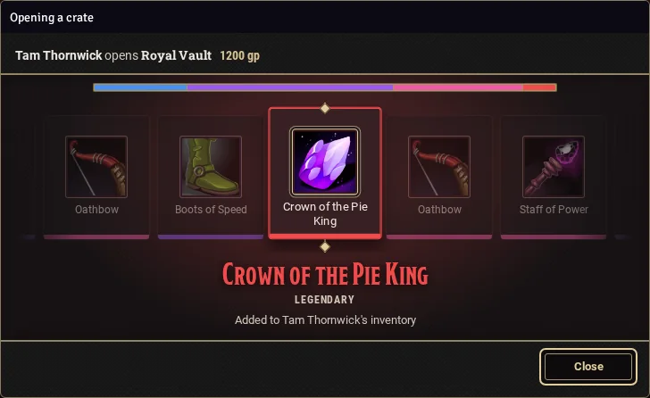
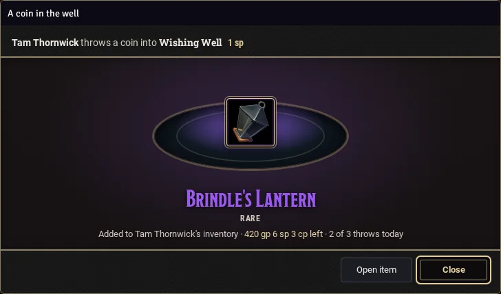
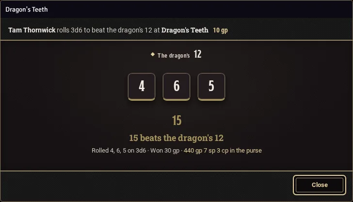
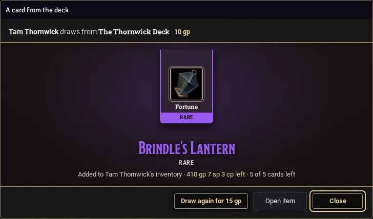
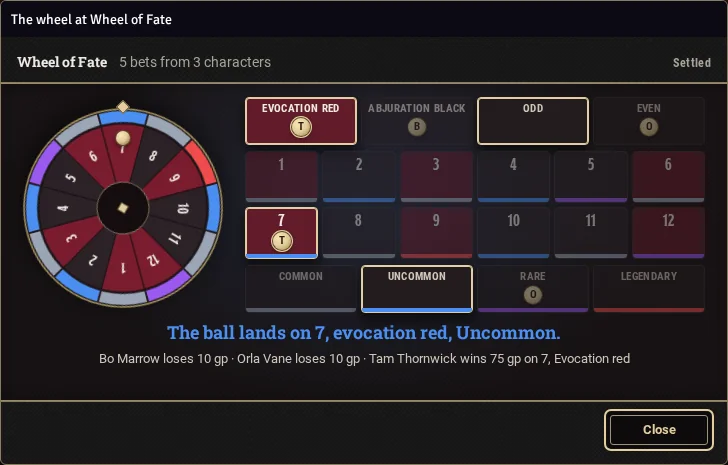
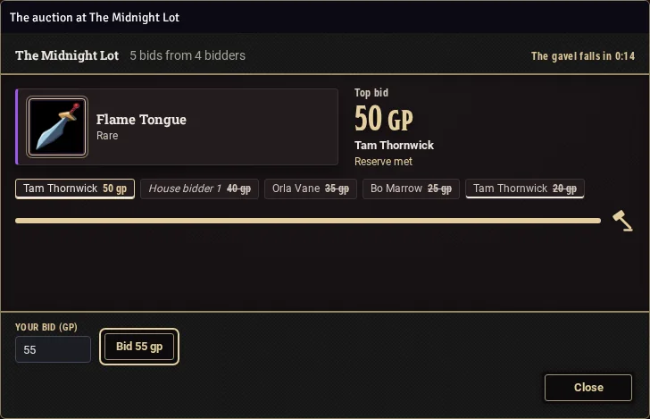

# Loot Crates

Loot Crates is a Foundry VTT module for D&D 5e that turns treasure into a game the whole table watches. The GM fills **pools** with magic items, sets the odds and the price, and players spend their character's own coins to open a crate. The crate spins on every screen at once, slows past the near-misses and lands on the find, which goes straight into the character's inventory. Beside the crate there are six more games of chance on the same rules: the Wishing Well, Dragon's Teeth dice, a Deck of Many Things, Roulette, an Auction and scratch tickets.



## Install

1. In Foundry's setup screen, open **Add-on Modules** and press **Install Module**.
2. Paste this manifest URL into **Manifest URL** and press **Install**:

   ```
   https://github.com/clearspec11/loot-crates/releases/latest/download/module.json
   ```

3. Launch your dnd5e world, open **Game Settings, Manage Modules**, tick **Loot Crates** and save.

| | Works with | Tested on |
| --- | --- | --- |
| Foundry VTT | v13.341 (the first stable v13) or later, and v14 | v14 (build 14.369) |
| D&D 5e system | 5.0.0 or later: 5.x and 6.x | 6.0.6 |
| Dice So Nice | optional | the dice game waits for its 3D roll |

Every check so far has run on Foundry v14 with dnd5e 6.0.6. The v13 and dnd5e 5 support comes from reading their API documentation and source, API by API, not from a test world: [docs/COMPATIBILITY.md](docs/COMPATIBILITY.md) lists what was checked and where. dnd5e 6 needs Foundry v14, so on v13 you'll be running dnd5e 5.

Players install nothing: Foundry serves the module to them when they join.

## Quick start for the GM

The first time you load the world, a welcome window says where everything is. It offers **Add starter crates**, which builds a full set for you (see [Starter crates](#starter-crates)). To build your own instead:

1. Open the **Items** sidebar and press **Manage crates** at the top. The manager has three tabs: **Pools**, **Boxes** and **Pull log**.
2. **Make a pool.** On the Pools tab press **New pool**, then drag items onto it from any compendium, a folder in the Items sidebar or a roll table. **Add from compendium** adds many at once, picked from a compendium by type, rarity and name. Each row's rarity decides the odds, and you can change it there.
3. **Make a crate.** Press **New crate from this pool** on the pool's bar, or **New box** on the Boxes tab. Type a price such as "50 gp" or "12 gp 5 sp", set the rarity odds and press **Add to shelf**.
4. **Open the shop.** **View shop** in the manager opens the shop as players see it. Players open it with the **Crates** button at the top of the Items sidebar. The shop starts open; the **Shop open** switch beside View shop closes it for a pause.
5. **Run a pull.** A player picks their character and presses **Open for 50 gp**. The coins come off the character, the spin plays for everyone, and a chat card names the find once each screen has landed.
6. **Refund.** Every play is a row on the **Pull log** tab. **Refund** on a row gives the coins back, takes the item off the sheet and undoes the pity count, so a misclick costs nothing.



## Starter crates

In a world with no games yet, the welcome window and the empty Pools and Boxes tabs offer **Add starter crates**. One press fills four pools from the dnd5e system's own compendiums (Potions and scrolls, Wondrous trinkets, Arms and armour, Dragon's hoard) and adds one game of every kind on them: three crates at 50, 250 and 1,000 gp, a Wishing Well, Dragon's Teeth, a Deck of Many Things, a roulette wheel, an auction, and two scratch tickets: the Market scratchie (1 gp, match 3, a roll of 50) and the Fortune ticket (10 gp, lucky numbers with a bonus spot, a roll of 100). Everything arrives **off the shelf**, so players see nothing until you put each game out from its row. They are ordinary games: edit, copy or delete them like any other.



## The games

Every game takes the character's own coins, is rolled by the GM's Foundry before anything is shown, and can be refunded from the Pull log. Make each one with its **New** button on the Boxes tab.

### Crates

A crate draws one item from its pools at the rarity odds you set, with an optional pity rule ("Rare or better within 10 pulls"), no duplicates and stock. The spin is a strip of items that slows down and lands on the find, with a near-miss now and then. Anyone can press **Watch again** on the chat card to replay it.



### Wishing Well

The quiet game: a player throws a copper or silver coin in. Almost always nothing happens, now and then the coin comes back, and rarely an item rises from the well's pools. You set how many throws each character gets per in-game day.



### Dragon's Teeth

A tavern dice game. The player bets the stake and rolls 2d6 or 3d6 against the dragon's number: beat it and win the stake times your multiplier, and a perfect roll can win an item too. The shop card shows the exact odds before anyone bets.



### Deck of Many Things

You write the deck: each card gives an item, pays out coins, takes coins, or reads out an effect you play at the table. Cards marked "once" leave the deck until you press **Reshuffle**. Each draw in a row costs more, and **Draw again** in the reveal offers the next one at its price. The five starting cards are placeholders for you to rewrite.



### Roulette

The first table game: everyone bets at once and one spin settles every bet. Bet on a colour, odd or even, a number or a rarity band; a rarity bet can also win an item of that rarity. You press **Open a round**, players press **Place a bet**, and you press **Spin** when the bets are in (or let the clock close them).



### Auction

Put one item, or a sealed crate, up for bids at the table, with an opening bid, a least raise, a reserve and optional house bidders. A bid holds its coins until it is beaten, then gives them back; only the winner pays. The gavel bar drains and fills again on every bid, and comes down by itself when it runs out (or press **Bring the gavel down**; **Call it off** returns every bid).



### Scratch tickets

You print a roll of tickets with a fixed prize list: so many tickets win coins, one or two win an item at a rarity from the ticket's pools, a few win the bonus spot, and the rest are duds. A prize can pay several things at once, as real tickets print them: press **Add a part** on its row to make it "a rare item + 25 gp + the gem" or "two items". A ticket wins one prize from the roll, so a ticket that pays twice is exactly as rare as you printed it. Each ticket bought comes off the roll, so the shop shows what is left (the tickets, and each prize still in the roll) and the odds of what is left. When the roll is sold out, press **Print a new roll** on its row. Pick **lucky numbers** (match any of your numbers to a lucky number to win the prize under it; wins add up) or **match 3** (three of a symbol win its prize). The editor reads out the roll's odds as you type the prize list: "1 in 2.3 tickets wins, the top prize (Rare item) 1 in 100, all prizes 5 gp or more". **Printed in** picks the ticket's colours: Dragon's hoard (crimson and gold), Fey market (green and silver), Arcane (violet and gold) or Royal mint (navy and gold); the ticket itself names its top prize and what the whole roll pays on its ribbon. A refund puts the ticket back in the roll. Untick **Players see what is left in the roll** to keep the counts to yourself: players then see the price, the top prize and the guarantee, as a printed ticket shows them, while you still see everything.

The buyer scratches the ticket themselves: hold the mouse button and rub the gold coin over the foil, panel by panel, until the card is open (a finger works on a touch screen). The arrow keys, Space and R work too, and **Reveal all** opens the whole card at once. Everyone else at the table watches the same coin scratch the card by itself, and the chat card stays sealed until it is open. The result was decided when the ticket was bought: scratching only shows it.

### Tickets

Any game players pull (a crate, the well, the dice, the deck, a scratch ticket) can also be a ticket a character carries. Press **Make a ticket** on its row in the Boxes tab: a ticket for that game appears in the Items sidebar, in the folder **Loot Crates tickets**. Drag it onto a character's sheet, a loot sheet or a merchant, or into a pool so a crate can drop one. Several of the same ticket stack. On the sheet a ticket has a **Use** button like any item: pressing it plays the game for the whole table exactly as a purchase does, with no coins taken, and one ticket is used up. A ticket still works when its game is off the shelf or the shop is closed; a ticket whose game was deleted says so and stays in the pack. If the game refuses (a sold-out roll, the well's daily limit) or the prize can't be added, the ticket isn't used. **Refund** on its Pull log row gives the ticket back and takes back what it won. The roulette wheel and the auction are played in rounds, so they have no tickets.

Players can buy tickets too. Under each game's Buy in the shop is **Buy to keep**: it costs the same and counts against the same stock and limit per character, but instead of playing now it puts a ticket in the character's pack (tickets bought at the same price stack), for a stack of scratchies for the road. Using a ticket bought this way doesn't count against the limit a second time. **Refund** on its Pull log row ("10 gp, kept") takes one of those tickets back out of the pack and returns the coins; if the character has none left (used or traded), the refund says so and nothing moves.

### Crates from roll tables

Already have loot tables? Right-click a table in the **Roll Tables** sidebar and choose **Make a crate**, or drop it on the Boxes tab. The crate keeps the table's own odds, so a 1 in 100 result stays 1 in 100, and nested tables are flattened. Type a price and press **Add to shelf**.

## Stock limits and the shelf

- **Stock.** Give a game a stock and the shop says what is left ("3 of 10 left"). Each sale takes one and a refund puts one back. **Restock** in the editor fills it again.
- **Limits.** Let each character buy a game a set number of times in all, or per in-game day. A refund gives the purchase back.
- **The shelf.** Each row on the Boxes tab has an **On the shelf** switch. A game off the shelf is hidden from players, so you can build next session's games ahead of time. One click puts it out in every open shop.
- **Copy** on a row makes a fresh copy of any game to rename and reprice.

## What players see

Players press **Crates** at the top of the Items sidebar. The shop shows every game on the shelf with its price and the odds *for their character*: items they already own are left out of a no-duplicates crate, and a pity countdown says how close a guarantee is. A game they can't afford says how much more they need. When someone opens a crate, every player sees the same spin, and the chat card stays sealed until their own spin lands, so nobody spoils it. The found item appears on the character sheet when the spin ends. Players never see the GM's manager or an auction's reserve.

## FAQ

**Does it work with no GM logged in?** No. The GM's Foundry rolls every result and moves every coin, so while no GM is online the shop reads "Closed until a GM is online." and nothing is charged.

**What if I make a mistake, or a player misclicks?** Press **Refund** on the row in the Pull log. The coins come back, the item leaves the sheet and pity and stock go back to where they were. If the player has already spent winnings, the refund says how much is short rather than making coins from nothing.

**Can players see what they will get before the spin ends?** No. The result is decided first, but the chat card, the sheet row and the shop's pity line stay hidden on each screen until that screen's spin lands.

**When does an in-game day end?** A character's throws at the Wishing Well and their purchases under a limit per day start again when their day ends. With dnd5e's calendar off, a day ends at each long rest that character takes. With the calendar on, it ends when the world's clock passes midnight or when the character takes a long rest, whichever comes first, and a second long rest on the same calendar day doesn't end another. If dnd5e's calendar is on but its daily uses come back at a long rest rather than on the clock, each long rest ends a day, as with the calendar off. A long rest ends only that character's day, and you never reset anything by hand.

**Does it respect reduced motion?** Yes. With reduced motion turned on in the operating system or browser, every game skips straight to its result. A tab in the background lands at once too.

**Does it work with Dice So Nice?** Yes. Dragon's Teeth waits for Dice So Nice's 3D roll and lands with it. The dice are Foundry's own, rolled on the GM.

**Can I turn the sounds off?** Each player can untick **Crate sounds** in Game Settings, Configure Settings, Loot Crates. The sounds also follow Foundry's interface volume.

**Do the result windows pile up?** No. Once a crate, the well, the dice or a deck has shown its result, or a table round has been settled or called off, its window closes by itself after 30 seconds. A small line in the window says "Closes in 30 s", with **Keep open** beside it to keep that one. The countdown waits while your pointer is over the window or you're using it from the keyboard, and never starts before the result shows. Each player chooses the delay (never, 10 seconds, 30 seconds or a minute) under **Close finished game windows** in Game Settings, Configure Settings, Loot Crates. **Watch again** on the chat card plays a result again. The shop, the manager and dialogs never close by themselves.

**Where did the welcome window go?** Game Settings, Configure Settings, Loot Crates, **Show the welcome** opens it again.

**Can I use it in another language?** Yes, once someone translates it. Every word the module shows is in one file, `module/lang/en.json`. To add a language, copy it to `lang/<code>.json` (for example `lang/de.json`), translate the values and keep the keys and the `{placeholders}` as they are, then add the language to `module.json`'s `languages`. Translations are welcome as a pull request on [GitHub](https://github.com/clearspec11/loot-crates).

**Where do I report a bug?** On the [issue tracker](https://github.com/clearspec11/loot-crates/issues). What changed in each version is in the [changelog](CHANGELOG.md).

## For developers

Start with [docs/DEVELOPING.md](docs/DEVELOPING.md): setup, the harness, tests, screenshots, live checks and where the code lives. How the module works is in [docs/ARCHITECTURE.md](docs/ARCHITECTURE.md), the design tokens and rules in [docs/DESIGN.md](docs/DESIGN.md), and releasing in [docs/RELEASE.md](docs/RELEASE.md).

```
npm install
npm run test:run      # the unit tests
npm run harness       # look at any window without Foundry: http://localhost:5281/harness/
```

Other modules can add a game of their own with `game.modules.get("loot-crates").api.registerKind`.
